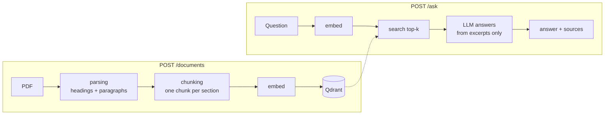

# tinyrag

A small, fully local retrieval-augmented generation (RAG) system for PDFs.
Upload a PDF, ask questions about it, and get answers with page-level sources.

- **Structure-based chunking:** headings are detected from font sizes, and chunks follow the document's own sections.
- **Local models:** embeddings and answers come from [Ollama](https://ollama.com); vectors are stored in [Qdrant](https://qdrant.tech) (embedded mode, no server needed).
- **Measured, not guessed:** an evaluation suite scores retrieval and answers separately and compares LLMs.

## How it works



**Example chunk.** The heading path is prepended to the text before it is embedded, so a paragraph about hotel costs is also found by a question about "travel expenses":

```
3 Reisen und Spesen > 3.1 Reisekosten

Dienstreisen mit der Bahn werden in der 2. Klasse gebucht; …
Die Hotelkosten dürfen 140 Euro pro Nacht nicht übersteigen. …
```

## Quickstart

Requirements: Python 3.13, [uv](https://docs.astral.sh/uv/), and an Ollama server with the two models:

```bash
ollama pull bge-m3
ollama pull gemma3:12b
```

Set up and start the API (configure the Ollama URL in `.env` if it is not `localhost`):

```bash
uv sync
cp .env.example .env
uv run uvicorn tinyrag.api:app
```

Interactive API docs (Swagger UI) are available at http://127.0.0.1:8000/docs.

Generate the sample PDF (a fictional employee handbook), upload it, and ask a question:

```bash
uv run python scripts/make_sample_pdf.py
curl -F "file=@data/pdfs/nordlicht_handbuch.pdf" http://127.0.0.1:8000/documents
curl -X POST http://127.0.0.1:8000/ask -H "Content-Type: application/json" \
     -d '{"question": "Wie viel darf ein Hotel in Esbjerg kosten?"}'
```

```json
{
  "answer": "Für Übernachtungen in Esbjerg gilt eine Obergrenze von 1.100 Dänischen Kronen pro Nacht [1].",
  "sources": [
    {"source": "nordlicht_handbuch.pdf", "page": 2, "section": "3 Reisen und Spesen > 3.1 Reisekosten", "score": 0.70},
    "…"
  ]
}
```

All settings (models, `top_k`, context size, storage path) live in [`config.py`](src/tinyrag/config.py) and can be overridden via `TINYRAG_*` environment variables.

## Project structure

```
src/tinyrag/
├── parsing.py     PDF → headings and paragraphs (font-size heuristic)
├── chunking.py    headings and paragraphs → chunks along the section structure
├── embedding.py   Embedder protocol + Ollama implementation
├── llm.py         LLM protocol + Ollama implementation
├── store.py       Qdrant: store and search chunk vectors
├── service.py     the two use cases: ingest_pdf() and ask(), incl. the prompt
├── api.py         FastAPI layer, a thin translation between HTTP and the service
├── models.py      shared data types (Element, Chunk, DocumentError)
└── config.py      settings
scripts/           sample PDF generator, PDF inspection tool
eval/              question catalog, evaluation script, results per model
tests/             unit and API tests (no network, no model downloads)
```

## Design decisions

| Decision | Why |
|---|---|
| Body text size = the font size covering the most **characters**; every larger size is a heading level | Works across documents without configuration; counting characters instead of lines keeps tables of contents from winning |
| Header/footer removed by a fixed band at the top and bottom of each page | Simple and predictable (see limitations) |
| The parser emits generic headings/paragraphs; the chunker knows nothing about PDFs | The chunker could serve Markdown or HTML parsers unchanged and is tested without font sizes |
| One chunk per lowest-level section; long sections split at paragraph boundaries (max 1,500 chars) | Sections are coherent units chosen by the author; chapters would blur several topics into one vector, single paragraphs lose context |
| Heading path prepended to the embedded text | Metadata does not influence vector similarity, so the context has to be in the text |
| Embedder and LLM behind `Protocol` interfaces, injected via constructor | Swap Ollama for another provider without touching the pipeline; tests run with fakes |
| No `Protocol` for the vector store | Tests use a real in-memory Qdrant; an interface without a second implementation would be dead weight |
| Uploads are parsed in memory, never written to disk | No path traversal via client-supplied file names, no leftover data |
| Re-uploading a file replaces its previous chunks | Ingestion is idempotent, so there are no duplicates |
| `temperature: 0` and an explicit `num_ctx` | Reproducible answers for evaluation; Ollama silently truncates prompts that exceed its default context |

## Evaluation

[`eval/questions.toml`](eval/questions.toml) contains 12 questions about the sample handbook in eight categories: direct facts, paraphrased and colloquial questions, exceptions, time limits, arithmetic, answers spread over two sections, a false premise, and two questions the document cannot answer. The handbook is fictional on purpose: an LLM cannot know its facts, so a correct answer proves that retrieval worked.

[`eval/evaluate.py`](eval/evaluate.py) runs every question through the API and measures:

- **Retrieval:** is the expected section ranked 1st (Hit@1) or among the top 5 sources (Hit@5)?
- **Answer:** does it contain the required terms (or correctly decline when the answer is not in the document)?

```bash
uv run python eval/evaluate.py data/pdfs/nordlicht_handbuch.pdf
```

### Results

Embeddings `bge-m3`, `top_k` 5. Retrieval is identical for all LLMs: **Hit@1 90 %, Hit@5 100 %**.

| LLM | Size | Correct answers | Avg. answer time |
|---|---|---|---|
| `qwen2.5:14b` | 9 GB | 8/12 (67 %) | 20.8 s |
| **`gemma3:12b`** (default) | 8 GB | **9/12 (75 %)** | **18.1 s** |
| `mistral-small:24b` | 14 GB | 9/12 (75 %) | 28.6 s |

Full reports: [`eval/results/`](eval/results/).

### Findings

- **Retrieval is not the bottleneck.** For every answerable question the right section was among the excerpts; all errors happen in the generation step.
- **No hallucinated facts on unanswerable questions.** Every model declined both questions whose answer is not in the document, including the tempting "special leave for my wedding" next to the regular vacation rules.
- **Three errors are shared by all models, so they are prompt issues, not model issues:** answers omit conditions (carry-over vacation without its March 31 deadline), no model correctly computes 14 days × 85 € = 1,190 €, and none corrects the false premise in "Why was the Esbjerg office opened in 2019?" (it was 2021).
- **Bigger is not automatically better.** `mistral-small:24b` was the only model that attempted the arithmetic and answered "1205 Euro" with a source citation. A confident, cited wrong number is more dangerous than an incomplete answer, and keyword checks cannot tell the two apart. Reading the answers is part of the evaluation.
- One check was corrected after the first run: question 6 required the word "nein", which marked a correct answer ("… sind ausgenommen") as wrong. The comment in the catalog documents the change.

## Known limitations

- **Header/footer detection** uses a fixed 50 pt band. Headers placed lower on the page slip through.
- **Hyphenation:** a word split at a line break keeps its hyphen ("Unter-nehmen"), because without a dictionary a syllable break cannot be told apart from a compound such as "Zwei-Faktor".
- **Heading detection** relies on font size only. Headings that are merely bold at body size are not recognized, and scanned PDFs without a text layer are rejected (HTTP 422).
- **Prompt injection:** document contents and file names end up in the LLM prompt. A malicious PDF can try to steer the answers.
- **Evaluation size:** 12 questions on a single, cleanly structured document give a first signal, not a benchmark.

## Possible next steps

- Improve the prompt for the three shared error classes, then validate on a **new** set of questions so the result is not tuned to the questions it is measured on.
- Evaluate a real-world document with messier layout (for example the German *Grundgesetz*, a public-domain official work).
- Add a re-ranking step or hybrid (keyword + vector) search, and grow the question catalog.

## Development

```bash
uv run pytest           # 34 tests, no network access needed
uv run ruff check .     # lint
uv run ruff format .    # format
```

`scripts/inspect_pdf.py` prints every text line of a PDF with font size, bold flag, and position, which helps when tuning the heading heuristic for a new document.

## License note

This project depends on [PyMuPDF](https://pymupdf.readthedocs.io), which is licensed under AGPL-3.0. Using it in a closed-source network service requires a commercial PyMuPDF license.
